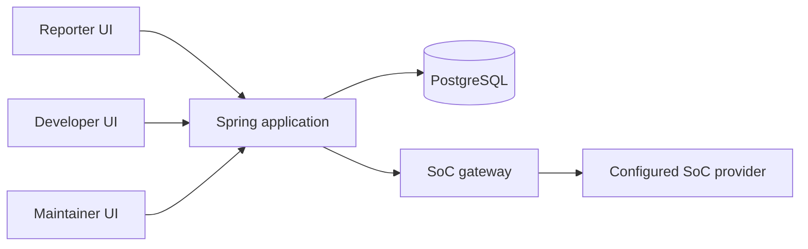

# BugBusters developer guide

## 1. Introduction

BugBusters is a programming-related bug tracker with Reporter, Developer and Maintainer workspaces. This guide covers local setup, the application boundaries, verification and deployment preparation. See the [User Guide](UserGuide.md) for role workflows.

This draft describes checkout `26f80a2` on `codex/developer-ai-refinement`. The locally recorded `origin/main` is ahead at `0747a59`; the remote could not be reached during this documentation work, so its current head and any deployment were not verified. Check `git status`, `git log` and the running revision before relying on branch-specific behavior. The shared-login, Developer navigation and workflow-evidence branches seen locally are separate work; do not assume they are merged or deployed.

## 2. Technology and repository layout

| Area | Location / technology |
| --- | --- |
| Role clients | `src/frontend/reporter`, `developer`, `maintainer`: React, TypeScript and Vite |
| Shared UI | `src/frontend/shared`, including the Markdown package |
| Backend | Java 17, Spring Boot/Security and Gradle wrapper; entry point in `src/backend/platform` and build in `src/backend/auth` |
| Persistence | PostgreSQL and Flyway; auth, shared and SoC histories are separate |
| Role services | `src/backend/reporter`, `developer`, `maintainer`, and `discussion` |
| AI | `src/backend/socllm` and role-specific gateway adapters in `platform` |
| Requirements and contracts | `openspec/` and `workflow/` |
| Verification and evidence | `workflow/verify.py`, `workflow/security/`, `logs/` and `.github/workflows/` |
| Product documentation | `docs/UserGuide.md` and this guide |

The browser sends requests to a single Spring application. The server derives the actor from its session, checks access and delegates to role services and PostgreSQL. State-changing requests use CSRF protection. The shared SoC gateway is server-side; generated text is untrusted and requires role-specific validation and user review.



## 3. Local setup

### Prerequisites

Install Java 17, Node.js and npm, Python 3, and PostgreSQL. The frontend deployment image uses Node 22; OpenSpec guidance recommends Node 24 or a compatible version. Database integration runners need PostgreSQL client and server tools, and some Reporter tests need Docker and a PostgreSQL JDBC JAR. See the [Reporter backend README](../src/backend/reporter/README.md) for its exact prerequisites.

Use a **new disposable database** and synthetic accounts. Do not point test runners at production or a shared development database. Startup applies migrations; see [database compatibility](#5-database-and-migrations) before using existing data.

### Configuration

1. Set `MP4_AUTH_JDBC_URL`, `MP4_AUTH_DB_USER`, `MP4_AUTH_DB_PASSWORD`, and `MP4_AUTH_RATE_LIMIT_SECRET` in the backend's environment. The JDBC URL has the form `jdbc:postgresql://HOST:PORT/DATABASE` without credentials or query parameters. Use a rate-limit secret of at least 32 UTF-8 bytes.
2. For HTTP on a loopback-only local backend, set `MP4_AUTH_LOCAL=true`. The backend defaults to `127.0.0.1:8080`; local cookies are rejected on non-loopback binds. Do not use this setting for a deployed service.
3. For an optional local AI configuration, copy `.env.example` to `.env` **only if you do not already have one**, then fill in the settings you need. The example defaults AI to disabled and contains no credentials. `.env` is ignored by Git and is not loaded automatically. Source only a trusted file; use shell quoting for values with special characters. The backend README shows how to load it into the shell. Keep real credentials out of commands, logs and version control.

The operator must provide database access and secrets; this repository does not supply default accounts or passwords. See [authentication configuration](../src/backend/auth/README.md) and [SoC setup](#7-ai-integration).

### Provision accounts

From `src/backend/auth`, use `provisionAccount` with `create`, `--username`, `--display-name`, `--role REPORTER|DEVELOPER|MAINTAINER`, and `--password-stdin`. The command reads 12–72 UTF-8 password bytes through EOF, including any final newline. Follow the private-input example in the [auth README](../src/backend/auth/README.md); do not put the password in arguments or shell history. Create three separate synthetic accounts for a role walkthrough.

The same command supports `reset-password --username VALUE --password-stdin` and `disable --username VALUE`. A password reset or disable invalidates existing sessions; a reset does not reactivate a disabled account. There is no public registration or browser password-reset page. Check the returned JSON code before assuming an operation succeeded.

### Run the backend and role clients

With the disposable database settings and rate-limit secret in the environment:

```sh
cd src/backend/auth
./gradlew runAuth
```

For Vite development, the checked-in proxies forward `/api` to `127.0.0.1:8080`. The login endpoint checks the browser origin. For example, run **one** role client at `http://127.0.0.1:5173`, set `MP4_AUTH_PUBLIC_ORIGIN=http://127.0.0.1:5173` in the backend environment before starting it, and use the same host and port in the browser. Restart the backend if its configured public origin changes. Do not expose the local HTTP server publicly.

Install dependencies once per package and start the desired client from the repository root:

```sh
cd src/frontend/shared/markdown && npm ci
cd ../../reporter && npm ci
npm run dev -- --host 127.0.0.1 --port 5173 --strictPort
```

For Developer or Maintainer, instead run `npm ci` in `src/frontend/developer` or `src/frontend/maintainer`, then use `npm run dev -- --host 127.0.0.1 --port 5173 --strictPort` for Developer or `npm start -- --host 127.0.0.1 --port 5173 --strictPort` for Maintainer. Open the URL Vite prints; Reporter and Developer use `/reporter/` and `/developer/` bases respectively. The Developer checklist demo component and the explicitly selected Maintainer demo are isolated synthetic previews, not evidence of authenticated persistence. Use the normal entry with the backend for integration testing.

To build the packaged application, use the [deployment Dockerfile instructions](../src/backend/platform/deployment/README.md). The Dockerfile builds all three frontend bundles and the Java distribution; the packaged routes are `/`, `/developer/` and `/reporter/`. Its runtime binds to all interfaces and uses secure cookies; use an HTTPS setup rather than enabling loopback-only cookies in that container.

## 4. Application and security boundaries

| Area | Current responsibility |
| --- | --- |
| Authentication | Operator-provisioned fixed-role accounts, server sessions, sign-in/out and CSRF. Account state is checked on protected access. |
| Reporter | Create and read own reports, edit while Submitted and unassigned, and participate in discussion. |
| Developer | Access assigned reports, start investigation, save private notes and checklist drafts, share saved checklists, request suggestions and submit resolutions. |
| Maintainer | Browse reports, set priority and assignment, discuss, return or close a resolution, reopen, and request an advisory queue summary. |
| Shared storage | Versioned report mutations and lifecycle checks protect against stale changes; shared checklist copies are separate from private drafts. |

Reporter checklist response and Reporter AI screens, Developer discussion, and AI assessment of responses are not exposed by the screens inspected in this checkout. Planning documents and isolated demos are not proof of a released feature. Verify contracts, current code and the target revision before extending a flow.

The session cookie is HttpOnly and SameSite=Lax, and Secure outside local loopback mode. Login rotates the session; clients obtain a CSRF token for writes. Do not trust a client-supplied role or actor identity. Treat report text, comments, checklist text and AI outputs as untrusted input. Consult the relevant contracts and security tests when changing authorization, rendering or AI boundaries.

## 5. Database and migrations

Startup initializes Flyway histories for auth (`mp4_auth_schema_history`), shared reports (`mp4_shared_schema_history`) and SoC (`mp4_socllm` schema). Auth migrations start at V100; shared migrations are assembled from shared, Maintainer, Reporter and Developer sources by the Gradle build. Inspect the current files and history rather than assuming version numbers from another branch.

Use a fresh database for new local work. Existing manual or older branch schemas need compatibility review before startup; a successful fresh install does not prove an existing-data upgrade. The shared bootstrap checks canonical schema compatibility, including defaults. Do not delete or rewrite Flyway history, force `repair`, reset a shared database, or run destructive reverse migrations to make an incompatible database start. Back up and design a data-preserving migration with the schema owners first. See the [Maintainer backend README](../src/backend/maintainer/README.md) and [shared storage README](../src/backend/shared/README.md).

## 6. Verification

A documented command is not a passing result. Record the revision, environment, exact command, result and any blocked checks for the work being reviewed.

### Frontend checks

After installing each package's dependencies:

```sh
cd src/frontend/developer && npm run verify
cd ../maintainer && npm run verify
cd ../shared/markdown && npm run verify
cd ../../reporter && npm run verify
```

Each `verify` runs type checks and tests; the role packages also build, while the shared Markdown package runs a Vite smoke check. These are component and build checks; they do not prove real authentication or database integration. The repository runner's frontend group currently covers Developer, Maintainer and shared Markdown, **not Reporter**; run Reporter separately.

### Backend, security and repository checks

From the repository root:

```sh
python3 workflow/verify.py
```

The default runs the defined frontend, backend, Reporter backend, security and tooling groups. Use `--group frontend`, `--group backend`, `--group reporter`, `--group security`, or `--group tooling` for a focused run; `--frontend developer`, `maintainer` or `shared/markdown` narrows the frontend group. See `python3 workflow/verify.py --help` and [verification instructions](../workflow/README.md). The Reporter group requires Docker, `python` on PATH and `POSTGRES_JDBC_JAR`; see its README. Security and tooling checks may need network access to download pinned tools; a missing tool, network failure or finding is a failure, not a pass. See [security checks](../workflow/security/README.md).

For the auth/backend suite alone:

```sh
python3 src/backend/auth/test/run_setup.py
```

This creates and removes its own temporary PostgreSQL cluster. It needs `initdb`, `pg_ctl` and `psql` on PATH or in `MP4_POSTGRES_BIN`, Java and the Gradle wrapper's dependencies. A focused run can add `--tests CLASS_OR_METHOD`; it still runs the setup control. Checklist persistence and Reporter integration have additional disposable-database instructions in their respective backend READMEs. CI has separate image and shared-storage checks; the local verification entry point does not establish every hosted or deployed check.

### Browser smoke test

Using a running integrated application, disposable database and separate synthetic accounts, follow the [complete workflow](UserGuide.md#try-the-complete-workflow): sign in as each role, create and assign a report, start investigation, save/share a checklist, submit a resolution and review it. Also try each role in a wrong-role workspace and confirm access is denied. Record the actual revision, results and sanitized evidence. A local browser login test reported for another worktree does not establish behavior for this checkout or a deployed service. Never capture real credentials or sensitive data in screenshots or traces.

## 7. AI integration

Live SoC access is disabled unless configured. `.env.example` lists `SOC_LLM_ENABLED`, `SOC_LLM_MODEL`, role-specific keys, `SOC_LLM_RPM` and `SOC_LLM_TPM`, plus optional Developer and Maintainer model overrides. A role without a configured key is unavailable. Check model access, provider connectivity and approved budgets before enabling it. A key or a passing fake-provider test does not prove live availability or quota compliance.

The gateway uses bounded requests, role routing and PostgreSQL admission controls. Its token setting is an application reservation budget, not a measurement of provider billing. The Developer suggestion flow sends the report and saved checklist, excluding unsaved edits and private notes; the Maintainer summary uses bounded selected queue context. Treat prompts and generated content as untrusted; keep credentials and unnecessary private data out of inputs and evidence. Test authorization, stale results, malformed output, limits and provider failures when changing AI behavior. See the [gateway README](../src/backend/socllm/README.md), [Developer AI contract](../workflow/developer/ai-checklist-contract.md), and [Maintainer README](../src/backend/maintainer/README.md). Some gateway documentation predates the Developer consumer; inspect the current endpoint and configuration as well.

## 8. Changes, OpenSpec and evidence

1. Check the branch and uncommitted work. Identify the matching OpenSpec change and task; read its spec, design, tasks and relevant contracts. For Developer checklist work also read the [storage contract](../workflow/developer/checklist-storage-contract.md). Resolve disagreements between spec, contract and tests with the feature owner.
2. Follow the [OpenSpec workflow](../workflow/openspec.md) and choose a proportionate path using [workflow selection](../workflow/workflow-selection.md). For low-risk work, the lightweight path permits one agent and focused checks. For the full path, prepare the contract, fixtures and runner, then follow the independent Red and candidate verification gates in the [TDD workflow](../workflow/tdd.md); authorization and AI security changes also need a separate security reviewer. Follow `AGENTS.md` for the applicable gates and checks.
3. Run the checks required for the affected task and record the result before marking it complete. Validate OpenSpec with `openspec validate --all --strict --no-interactive` when the pinned CLI is installed.
4. Keep evidence proportionate but specific: summarize the goal, changes, checks, review findings and limitations first; then record revisions, context supplied, coordination, commands, results and available resource measurements. Mark unavailable measurements as unavailable. Do not invent token use, savings, test results or deployment evidence. See [TDD evidence format](../workflow/tdd.md#evidence) and [evaluation guidance](../workflow/evaluation/context-resource-evidence.md).

Use targeted context and focused checks appropriate to the change, then run the required broader checks. Preserve other contributors' work and avoid logging secrets or report contents unnecessarily.

## 9. Deployment and release

The repository contains separate development and production Render blueprints and GitHub deployment workflows. The container build includes all three clients and exposes `/assets/revision.txt` for its build revision. Review [deployment instructions](../src/backend/platform/deployment/README.md), workflow files and the actual environment configuration before release; documentation of a blueprint is not evidence that it is deployed.

Use separate databases, keys, rate-limit secrets, public origins and environment-scoped deployment hooks for development and production. Use HTTPS and configure the exact public origin. The workflows gate deployment on the relevant `main` revision and CI; production also checks reviewer configuration. Verify actual environment protections, secret scopes and current CI results before dispatching. Creating cloud resources or deploying requires the appropriate project authorization.

Before release, review migration compatibility and backups, run the applicable checks, then verify the deployed revision, login, role access, report flow and AI availability using approved synthetic data. For rollback, review schema compatibility and select a previously verified deployment; preserve data and migration history. Live hosting, release permissions and rollback were not verified while writing this guide.

## 10. Troubleshooting and known limits

| Problem | Check |
| --- | --- |
| Backend fails at startup | Database URL, credentials, rate-limit secret, database availability and migration compatibility. Do not print secrets or reset history. |
| Local login or CSRF fails | Correct account and role, loopback local-cookie setting, browser origin and `MP4_AUTH_PUBLIC_ORIGIN`; use the same host and port consistently. |
| A report is missing | Reporter ownership, Developer assignment, filters and current session. |
| AI unavailable or rate limited | Enable flag, selected model, role key, budget and provider access; manual workflows remain available. |
| Test runner cannot start | Required tools, dependencies, network access and disposable PostgreSQL prerequisites; distinguish setup failure from an application failure. |
| Existing database rejected | Stop and review the actual schema and history with owners; do not force a repair. |

This guide is a draft. The commands were checked against repository scripts and documentation, but the full suite, live AI, integrated browser flow and deployment were not rerun for this document. Refresh the guide after integration or a release.

## 11. Acknowledgements

The application uses the frameworks and libraries declared in its Gradle and npm manifests, including Spring, PostgreSQL, Flyway, React and Vite. The repository's [security guidance](../workflow/security/README.md) identifies its scanning tools and their upstream documentation. Review dependency licenses and the project reuse inventory before submission; this guide does not claim a complete attribution audit.
