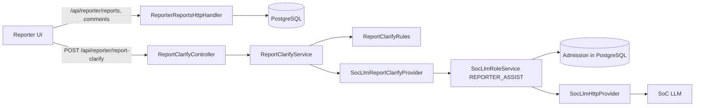

# Reporter contribution to DeveloperGuide

Implemented the Reporter role against the shared Java/PostgreSQL application: report
creation, listing, editing and discussion, plus the **Check my report** AI feature
(`openspec/changes/reporter-report-clarify`). This describes branch `llm-reporter`
(base `1b2d3b7`); the Reporter AI work is uncommitted at the time of writing. MP2
supplied the documentation structure only; no MP2/MP3 application code was reused.

## 1. Design goals

- The server derives the Reporter from the session; request bodies never choose the
  actor, role, policy or model.
- A failed request never loses the draft, and error messages never repeat user text.
- Report text and AI output are untrusted. The server validates AI output strictly,
  and the browser renders it as plain text.
- The AI only asks questions. It never changes or stores a draft, which avoids the
  content loss seen when models restructured long reports
  (`logs/reporter-report-clarify/trial-structure-2026-11-12.md`).
- Raising AI limits for the Reporter must not raise them for Developer or Maintainer.

## 2. Components and repository layout

| Area | Location | Responsibility |
| --- | --- | --- |
| Reporter UI | `src/frontend/reporter/src` | `App` (hash routes, sign-in), `ReportList`, `NewReport`, `ReportView`, `ReportCheck` (results panel), `api.ts` (typed client and response parsing), `format.ts` (text rules) |
| Shared Markdown | `src/frontend/shared/markdown` | `MarkdownEditor` / `MarkdownView` with worker parsing; used for descriptions and comments |
| Report API | `src/backend/reporter/src` | `ReporterReportsHttpHandler` (routing, validation, errors) and `ReporterReportStore` (JDBC) |
| Discussion | `src/backend/discussion` | Comment endpoints, `StrictJson`, `TextRules` |
| Report check | `src/backend/platform/src/main/java/mp4/platform/ReportClarify*` | Controller, service, rules (prompt, validation, screening), configuration |
| AI gateway | `src/backend/socllm` | `SocLlmTaskPolicy` / `SocLlmTaskPolicies`, `SocLlmRoleService`, `SocLlmHttpProvider`, PostgreSQL admission |
| Contracts | `workflow/reporter/` | `reporter-reports-api-contract.md` (approved, read-only), `report-discussion-api-contract.md`, `report-clarify-api-contract.md` (draft) |
| Requirements | `openspec/changes/` | `reporter-markdown-reports`, `report-discussion`, `reporter-report-clarify`, `socllm-per-task-limits` |

## 3. Workflows

### 3.1 Create, list, edit and comment

`POST /api/reporter/reports` validates exactly `{title, description}`: title 1-200
UTF-16 units on one line; description 1-20,000 units; no NUL or lone surrogates. It
allows 3 creations per Reporter per rolling minute (429 with `Retry-After`). Values are
stored exactly as typed; the server never renders Markdown. Lists are newest first,
own reports only; another Reporter's report returns the same 404 as a missing one.
`PUT` edits require the current `version` and a `SUBMITTED`, unassigned report
(409 `REPORT_LOCKED` / `VERSION_CONFLICT`). Comments are served by the discussion
module and allowed on closed reports. See `src/backend/reporter/README.md`.

### 3.2 Check my report

1. `NewReport` runs the local title and description checks, aborts any earlier check,
   and sends `{title, description}` with the CSRF token.
2. `ReportClarifyController` (`POST /api/reporter/report-clarify`) requires a fresh
   Reporter session, an active account of the same generation, JSON, no query string
   and a body of at most 128 KiB. It checks the session again before returning a
   result, and discards the result if anything changed.
3. `ReportClarifyService` parses the request with the report-creation text rules and
   calls the provider. Refusals never reach the gateway.
4. `SocLlmReportClarifyProvider` sends `Call(REPORTER, actor, REPORTER_ASSIST, ...)`
   with 8,192 output tokens and a 60 s deadline. The gateway applies the
   `REPORTER_ASSIST` policy and the shared per-key admission.
5. `ReportClarifyRules.validateOutput` accepts only
   `{unclear:[{quote,question}], missing:[{category,question}]}` and returns it to the
   browser, which re-checks the shape and renders text nodes only.

Status codes: 400 validation, 401 session, 403 role/CSRF, 409 `AI_BUSY`,
429 `AI_RATE_LIMITED`, 502 `AI_INVALID_OUTPUT`, 503 `AI_UNAVAILABLE` /
`STORAGE_UNAVAILABLE`, 504 `AI_TIMEOUT`. See
`workflow/reporter/report-clarify-api-contract.md`.

## 4. Component design

### 4.1 Prompt and output rules (`ReportClarifyRules`)

- **Input framing:** the system message holds the trusted instructions; the user
  message is `Report title:` / `Report description (untrusted):`. The instructions
  forbid invented facts, quoting the New Report template's headings or empty `1.`,
  and asking for screenshots (descriptions cannot show images).
- **Structure:** at most 8 unclear items with unique quotes that appear **exactly** in
  the title or description; at most 7 missing items from the fixed categories, each
  once; questions 1-300 characters. Extra keys, wrong types or bad structure reject
  the whole result (502).
- **Screening (RC-07b):** text is normalized (NFKC, default-ignorable and format
  characters removed, lowercased; `_`, `-` and camelCase as word breaks). A question
  with a URL, `hxxp`, an email address or a credential request drops **only its own
  item**. If every item is dropped, the result is 502, never an empty "nothing to ask".
- **Visible text (RC-07c):** a question is rejected (whole result) if it contains
  controls, line or paragraph separators, bidi or direction marks, default-ignorable
  or format characters, U+2800, U+FFFC, U+1D159, private-use or unassigned code
  points, or has no letter or digit.
- **Telemetry:** outcome, model, duration, item counts. Never draft text, quotes,
  questions or model output. Token counts log as `unavailable` because the gateway
  returns content only.

### 4.2 Gateway limits

| Task | Input bytes | Output tokens | Deadline | Starts / account | Reservation |
| --- | ---: | ---: | ---: | --- | ---: |
| `REPORTER_ASSIST` | 61,440 | 8,192 | 60 s | 3 per 5 min | 77,824 |
| `DEVELOPER_ASSIST`, `MAINTAINER_QUEUE_SUMMARY` | 24,576 | 2,048 | 30 s | 3 per 5 min | 34,816 |

Transport ceilings (`SocLlmTaskPolicy`) are 61,440 / 8,192 bytes, 8,192 tokens and
60 s, with a 384 KiB request and 64 KiB response. A policy can only tighten them. The
request has exactly `model`, `messages`, `max_tokens`, `stream` and `response_format`;
no `reasoning_effort` is sent, so the provider default applies. The large output budget
is headroom for that unbounded default reasoning.

### 4.3 Model choice

Model trials are recorded in `logs/reporter-report-clarify/`. The question-only format
passed on `qwen3.8:27b`, `x-test-2` and mostly on `qwen3.6:35b`. The owner chose
`x-test-2` without a reasoning field: 4/4 in 10.7-33.6 s, at most 2,779 output tokens.
`x-test-2` is a provider test slot whose backing model can change, so re-check it
before relying on it.

## 5. Configuration

Copy `.env.example` to `.env` (not loaded automatically) and export the values:

| Variable | Notes |
| --- | --- |
| `SOC_LLM_ENABLED=true` | Required for any live AI |
| `SOC_LLM_MODEL` | Shared model, required when enabled |
| `SOC_LLM_API_KEY_REPORTER` | Without it the check returns 503; report creation still works |
| `SOC_LLM_MODEL_REPORTER` | Optional; blank falls back to `SOC_LLM_MODEL` |
| `SOC_LLM_RPM`, `SOC_LLM_TPM` | `SOC_LLM_TPM` must be at least 77,824 or every check fails admission |

For Vite development against a backend that is not on the checked-in proxy port,
either set `MP4_AUTH_PUBLIC_ORIGIN` to the browser origin or use a proxy with
`changeOrigin: false`. Vite's string shorthand proxy rewrites the `Host` header, and the
login same-origin check then returns 403.

## 6. Verification

| Area | Command | Latest result |
| --- | --- | --- |
| Reporter UI | `cd src/frontend/reporter && npm run verify` | 23/23 tests, typecheck and build pass |
| Report check backend | `./gradlew.bat --no-daemon test --tests 'mp4.platform.ReportClarify*'` from `src/backend/auth` | 82/82 incl. 7 RC-07c visible-character tests |
| Real-session access (RC-02) | `--tests mp4.auth.ReportClarifyAuthenticatedIntegrationTest` with `MP4_AUTH_TEST_*` | 5/5 on Docker PostgreSQL |
| Whole backend | `./gradlew.bat --no-daemon test` with `MP4_AUTH_TEST_*` | 337/0 before the RC-07c fix; rerun pending |
| Report API | `python workflow/verify.py --group reporter` (Docker, `POSTGRES_JDBC_JAR`) | Not rerun for this change |
| Live check | 10 synthetic drafts through the real endpoint | 10/10 returned in 9-35 s; no injection followed |

Without local PostgreSQL tools, a disposable Docker database works:
`docker run -d --name mp4-clarify-test-pg -e POSTGRES_PASSWORD=... -e POSTGRES_DB=mp4_auth_setup -p 127.0.0.1:55433:5432 postgres:17-alpine`,
then set `MP4_AUTH_TEST_JDBC_URL`, `MP4_AUTH_TEST_DB_USER` and `MP4_AUTH_TEST_DB_PASSWORD`.
If Vitest reports *failed to find the runner*, delete `node_modules/.vitest-cache` and
`node_modules/.vite/vitest`; a stale cache with two Vitest copies (the Reporter's and the
linked shared package's) caused it locally.

Groups 1 and 2 of `reporter-report-clarify` followed the TDD workflow with independent
baseline, candidate and security reviews. Groups 3 and 4 were built without TDD by owner
decision. A final candidate review passed; the final security review's findings and
their status are in `logs/reporter-report-clarify/group4.md`.

## 7. Limitations

- The check works only on new drafts, and results are not stored.
- Screening is a blocklist backstop: lookalike letters, `api.key`, `password1`/`token2`
  and some URL/email spellings still pass. Plain-text rendering and the
  author-only audience limit the impact.
- `x-test-2` is a test slot; token usage is not reported by the gateway.
- 60 s calls on the Reporter's 2-worker, 8-queue pool can be saturated by a few
  active Reporters; they fail closed as busy or timeout.
- Per-task admission counting (`socllm-per-task-limits` 3.1/3.2) is not built; limits
  are counted per role, which is equivalent while each role has one task.
- The direct Maintainer summary path and the provider's `max_tokens` ceiling check
  remain open Low gateway findings.
- The Reporter screen does not show checklists or per-step responses.

## 8. Acknowledgements

Used Spring Boot/Security, PostgreSQL/Flyway, React, Vite and Vitest through the
repository's declared dependencies, and the NUS SoC LLM service. Followed MP2's guide
structure for documentation. Used OpenSpec for requirements and Claude Code with the
project's specialist agents for development and review.
